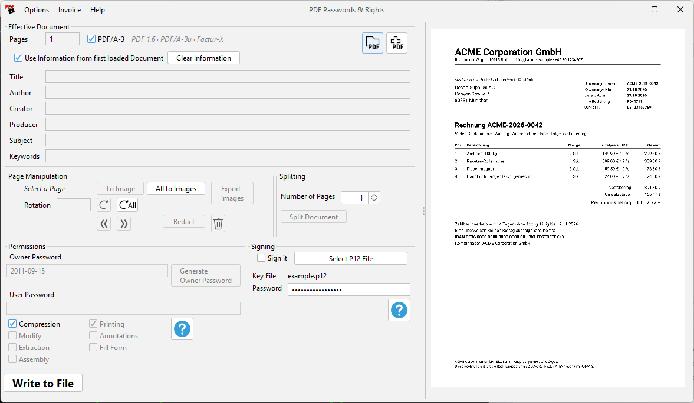

= jPdfTool

Apache PDFBox based tool to modify PDFs without paying any money.

This project began when I needed to protect a scanned PDF for an email, but the HP Scanner software couldn’t handle it. My old Brother scanner had this feature - plus other useful tools - and (by the way) worked without requiring any registration. +
Rather than paying for Adobe or other commercial solutions, I turned to the PDFBox documentation.  +
I had used PDFBox in previous commercial projects, though I’d never dealt with PDF protection before.

Thirty minutes later, the first version was up and running, and I sent the email. +
The following days were spent adding fancy features to the UI and the build system - just for fun.

<<<

== Current Features

=== Load a PDF
Easily import PDF documents for editing

=== Merge Multiple PDFs
Add additional PDFs and either mix pages or append them sequentially.

=== Set Owner and User Passwords
You can simply set a user password to restrict who can view the document. +
Or you can set an owner password and control specific permissions. +
Or you can do both.

=== Enable/Disable Compression
Toggle compression to optimize file size.

=== Set Permissions
Permissions only take effect when an owner password is set. +
The UI automatically disables permission checkboxes unless the password is provided.

=== Remove &amp; Rearrange Pages
Delete pages or change their order.

=== Rotate Pages
Rotate pages by 90°, 180° or 270°.

=== Preview PDF
For you convenience the document is shown using PDFBox’s rendering engine (rending runs in background).

=== Export Embedded Images

Display and export embedded images. +
Some PDF tools seems to split images into fragments - this tool can provide a merged version for you.

=== Convert Page to a single Image

This effectively removes any hidden objects if you e.g. tried to redact documents but hidden text- or image-objects are still in the document. +

<<<

=== Redact Text and Areas

Permanently removes text matching a regular expression or rectangular areas. +
In the UI, open the redaction dialog of a page, mark areas with the mouse or search for text. The help button of the dialog explains the details. +
In the CLI, use `--redactText <regex>` and `--redactArea <page>:<x>,<y>,<width>,<height>`. Areas are given in points (1/72 inch) from the upper left corner of the page: `--redactArea 1:50,100,200,20`. Both options can be repeated.

How it works: affected pages are rendered to an image, the areas are painted (black by default) and the page is replaced by that image. So the redacted content (and any other text on that page) is really gone and not just covered. Pages without redacted areas are not changed.

On redacted pages, text can't be selected or searched anymore, and annotations (links, comments, form fields) are dropped.

[IMPORTANT%unbreakable]
====
Redaction only cleans the *content of the pages*. The following is *not* removed, check it yourself before you share a redacted document:

* Bookmarks (outline), document information (title, author, ...) and XMP metadata.
* Attached files. An e-invoice is detected: the UI asks what to do, the CLI refuses unless `--removeInvoice` is given (see below).
* Values of form fields, they are stored outside the pages.

Text search only finds real text, not text inside images (e.g. scanned pages). Mark such areas by hand.
====

<<<

=== E-Invoices (ZUGFeRD / Factur-X)
Handles hybrid e-invoices: a PDF that carries the invoice as CII XML attachment (`factur-x.xml`, `ZUGFeRD-invoice.xml` or `xrechnung.xml`). +
Pure XML invoices (XRechnung) are not supported. Based on the https://www.mustangproject.org[Mustang] library.

* The UI menu *Invoice* shows the invoice data, validates the document (PDF/A-3 and EN 16931 rules), saves the XML, attaches an XML or removes the invoice.
* *Invoice > Create Invoice…* (or *Edit Invoice…* if the document has one) opens an editor for the invoice data: number, dates, seller, buyer, payment and items, with live totals. It creates profile EN 16931 or XRechnung and attaches it, or saves the XML. Missing data is listed before attaching. Seller (including the bank account) and buyer can be chosen from presets; the seller preset used last is the default for the next new invoice. All data of an existing invoice is kept, also data without a field in the form (e.g. allowances or a delivery address): the tab *All fields* shows every value of the XML as a table, where values and attributes can be changed and values removed. The sums (item totals, VAT breakdown, totals) are calculated again on each change, including allowances and charges. For the profiles MINIMUM and BASIC WL, which have no items, the editor shows a table of net amounts per VAT rate instead; the VAT, the totals and for BASIC WL the VAT breakdown are calculated from it. Fields a profile doesn't have (e.g. addresses in MINIMUM, contact person, account holder and BIC in BASIC WL) are disabled and not written. The service period (start and end, BG-14) is edited for the whole invoice only; a period of single items (BG-26) can't be entered, but an existing one is kept.
* Seller and buyer presets can be managed with *Manage…* in the editor or *Options > Invoice Parties…*: a list with buttons to add and remove entries, and an editor for the selected one. Each entry can be used as seller, as buyer or both, the preset lists of the editor only show the matching entries. The list is stored in `~/.jPdfTool/parties.json`. A buyer can have default payment terms and days until due: choosing it in a new invoice fills the payment terms and the due date, if they are still empty. The editor also notes, without blocking, if neither a delivery date nor a service period is given, or if the delivery date lies outside the period.
* CLI: `--extractInvoice <xml file>`, `--attachInvoice <xml file>`, `--removeInvoice` and `--validateInvoice` (validates the resulting file).
* Merging keeps the invoice. If both documents contain an invoice, only the one of the first document is kept.
* Splitting keeps the invoice in the *first* part only, as a part is not the complete invoice any more.
* Redaction doesn't touch the invoice data, so confidential data may remain in the XML. The UI asks what to do, the CLI refuses to redact such a document unless `--removeInvoice` is given.
* Attaching an XML fails with an error (CLI exit code 13) if the result is not a conform PDF/A-3 / EN 16931 document, e.g. because the PDF uses fonts that are not embedded. The document is not changed then. Converting arbitrary PDFs to PDF/A-3 is not supported.
* Encryption is not allowed for PDF/A-3. An encrypted document is no valid e-invoice any more. The CLI only encrypts if a password is given and logs a warning then.

<<<

* The UI has the option *PDF/A-3* beside the page count. It disables everything that would violate the standard: passwords, permissions and encryption, splitting, appending documents that are no PDF/A, and converting pages to images (including redaction) if the document has a non-RGB output intent (e.g. CMYK). A document without output intent gets an sRGB output intent (the profile Mustang also uses for e-invoices), so its pages can be converted to images. It is set automatically when a PDF/A-3 document or an e-invoice is opened, or when an invoice is added (attached or by appending a document), and can be changed. Without it, the passwords are used as entered; saving an e-invoice with encryption shows a warning.
* The document information (title, author, ...) is also written to the XMP metadata, as PDF/A requires both to be equal.

=== Remember Passwords

[%unbreakable]
--
The option *Remember Passwords* stores the owner, user and signature passwords in the user preferences. +
*Note:* The passwords are stored *unencrypted* (on Windows in the registry, on Linux/macOS in a file in your home directory). Every program running under your account can read them. Don't use this option on shared computers.
--

[%unbreakable]
=== Load Protected PDFs

Allows you to remove or change existing passwords. +
If the current entered owner password does not match the original password of the loaded PDF, the UI will prompt you to
enter the correct one. +
This password input is masked and will not be shown in the UI afterward.

=== Write to File

Saves your modified PDF.

=== Split into Multiple Documents

Export the PDF into separate documents.

=== Switch "Look-And-Feels"

Toggle between FlatLaf Dark/Light themes or system defaults. +
The setting is stored in user-preferences.

=== Sign the File with a Certificate

Sign the file using a certificate. +
A `.p12` file with an X.509 certificate is required.

== TODOs

E-mail me if I missed important features. 

== Supported Operating Systems

Distributions are currently only created for *MS Windows*.

The OS-dependent components are only the starter executable and the bundled JRE, designed to make it eeeeasy for Windows users.

The included JAR files in the `lib` folder should run on *any operating system with Java installed*.

For example, on *Linux* or *macOS*, you can run the application using the following command:

[source%unbreakable,console]
----
java -cp "$(printf %s: lib/*.jar)" com.bw.jPdfTool.Main
----

This command simply adds all JARs in the lib folder to the classpath.
The main class is `com.bw.jPdfTool.Main`.
Calling it without any arguments will launch the *Graphical User Interface (GUI)*. +
Calling it with only file names (no options) opens these files in the GUI, e.g. `jPdfTool.exe a.pdf b.pdf` loads `a.pdf` and appends `b.pdf`.

== Command Line Interface (CLI)

In case you need to call the tool from a *CI/CD Pipeline* or script,
you can use the CLI. +
I assume you have a basic understanding of command-line operations.

*Prerequisites:*

* The current directory of your shell (e.g. Bash) is in the distribution root directory.
* You have a *Java Runtime Environment (JRE)* installed - _see below for *headless* environments_.

To show the usage information of the CLI, use:

[source%unbreakable,console]
----
java -cp "$(printf %s: lib/*.jar)" com.bw.jPdfTool.Main -h
----

Add `--debug` to see debug output and stack traces. It also works together with file names to start the UI in debug mode (for the UI or the exe you can also set the system property `jpdftool.debug=true`).

<<<

=== Exit Codes

[%unbreakable,cols="1,6"]
|===
|Code |Meaning

|0  |Success.
|1  |Unexpected error, see the error output (use `--debug` for the stack trace).
|2  |No input files given, or invalid command line arguments.
|3  |No output file (`--out`) given.
|4  |Malformed `--merge` argument (not `<start>-<amount>-<skip>`).
|5  |Illegal number in the `--merge` argument.
|6  |Malformed `--redactText` or `--redactArea` argument.
|7  |`--validateInvoice` combined with `--split`.
|8  |`--extractInvoice` given, but the document contains no invoice.
|9  |Redaction requested for a document with an invoice, but no `--removeInvoice` given.
|10 |The invoice XML (`--attachInvoice`) or the certificate (`--certificate`) doesn't exist.
|11 |The validation of the result failed to run.
|12 |The result is no valid invoice (`--validateInvoice`).
|13 |The attached invoice would not be a conform PDF/A-3 / EN 16931 document. The document is not changed.
|14 |An input file can't be loaded (e.g. wrong or missing password, broken file) or merged. No output is written.
|===

*Note:* The CLI currently supports only a subset of the tool's total functionality. +
Feel free to ask in case you need special functionality.

<<<

=== Headless Environment Considerations

Because the tool uses *PDFBox* for all the magic, there are special considerations for headless environments:

* *GUI is not created for CLI:* +
  If the CLI is used, the User Interface is not created, so it should run on a headless system (a server without a display).
* *AWT Dependency:* +
    PDFBox internally uses some *Abstract Window Toolkit (AWT)* classes. These classes may require a *full JRE* to work, even if the application is running "off-screen" without a physical display installed. +
    *Pure Headless JRE Risk:* A _pure_ headless JRE might throw an error when an AWT class is instantiated. While you might use the CLI on a headless system, using a JRE specifically configured as _purely_ headless may be problematic.

*Recommendation:* Try running it. Success depends on the specific headless JRE implementation you are using.

== Dependencies

The libraries the tool uses (versions are defined in `build.gradle`):

[cols="2,3,5",options="header"]
|===
|Library |Used for |Task

|https://pdfbox.apache.org[Apache PDFBox] (`pdfbox`, `fontbox`)
|PDF handling
|Reads and writes PDF files and renders the pages for the thumbnails and the page images. It also provides the document structure for merging, splitting, rotating, deleting, redacting, encrypting and signing, and the fonts for the text extraction.

|https://commons.apache.org/proper/commons-logging/[Commons Logging]
|Logging of PDFBox
|PDFBox writes its messages through it. The version is fixed to the one PDFBox uses.

|https://www.bouncycastle.org/java.html[Bouncy Castle] (`bcprov`, `bcpkix`)
|Digital signatures
|Creates the PKCS#7 signature and handles the certificates when a file is signed with `--certificate`.

|https://www.mustangproject.org[Mustang] (`library`, `validator`)
|E-invoices (ZUGFeRD / Factur-X)
|Attaches the invoice XML to a PDF/A-3 document, adds the e-invoice metadata and validates PDF/A-3 and the EN 16931 rules.

|https://github.com/qos-ch/slf4j[SLF4J] (`slf4j-nop`)
|Logging of Mustang
|Discards the log output of Mustang, which would otherwise disturb the console.

|https://github.com/FasterXML/jackson[Jackson] (`jackson-databind`)
|JSON
|Stores the seller and buyer presets in `~/.jPdfTool/parties.json`. The version is the one Mustang uses.

|https://www.formdev.com/flatlaf/[FlatLaf] (`flatlaf`, `flatlaf-fonts-roboto`)
|User interface
|The modern Look-And-Feel, including the light and dark themes, and the Roboto font.

|https://github.com/bweng20/jSVGIcon[jSVGIcon]
|Icons
|Converts the SVG files of the icons (e.g. `calendar.svg`) to Swing icons that scale with the font size.

|https://picocli.info[picocli]
|Command line interface
|Parses the command line options, creates the help text and the exit codes. The annotation processor `picocli-codegen` checks the option annotations while compiling.

|https://junit.org/junit5/[JUnit 5]
|Tests
|Runs the unit tests (test scope only, not part of the application).
|===
